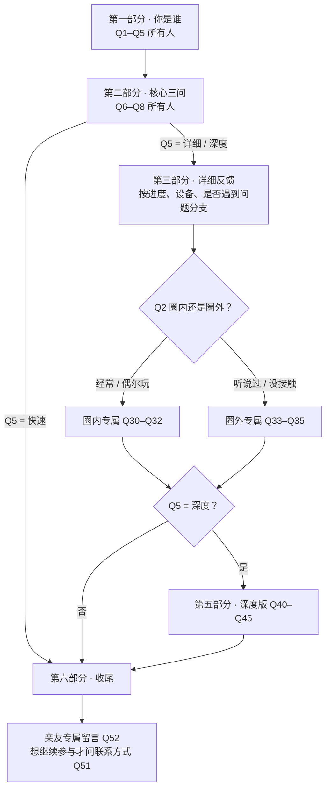

# 《飞 Fly》试玩调查问卷（设计稿）

> 适用平台：问卷星 / 腾讯问卷（都支持「显示逻辑」多条件 且/或、「跳转逻辑」）。
> 设计思路：**先认人、再选深度**。前 5 题所有人都答，之后按「想答多少」分三条路：
> **快速版 ≈ 1 分钟 → 详细版 ≈ 5 分钟 → 深度版 ≈ 10 分钟以上**；圈内 / 圈外 / 亲友再各自多看到几道专属题。

---

## 一、整体流程

---

## 二、题目清单

题号是固定编号，逻辑都按编号写。**「显示条件」留空 = 所有人都看到。**

### 开头说明（放在问卷说明栏）

> 谢谢你玩《飞 Fly》！这是我（Endnd）国庆七天做的第一部视觉小说，还很粗糙。
> 问卷**匿名**，最快 1 分钟就能填完；想多说几句的话也有地方写。
> **说缺点比说好话对我帮助更大**，请放心吐槽 ( ´ ▽ ` )ﾉ

### 第一部分 · 你是谁（所有人）

| 题号 | 题目 | 题型 | 选项 | 必答 |
|---|---|---|---|---|
| Q1 | 你和作者是什么关系？ | 单选 | A 家人 / 亲戚　B 同学 / 朋友　C 网友（作者分享给我的）　D 不认识，偶然看到的　E 其他 | 是 |
| Q2 | 你平时玩视觉小说 / Galgame / 文字冒险游戏吗？ | 单选 | A 经常玩，算圈内人　B 偶尔玩过几部　C 听说过，没怎么玩过　D 完全没接触过 | 是 |
| Q3 | 你玩到了哪里？ | 单选 | A 只看了开场 / 创作声明　B 玩到第一、二章（起飞那段）　C 玩到第三、四章（梦里）　D 打出了一个结局　E 两个结局都看了 | 是 |
| Q4 | 你在哪个设备上玩的？ | 单选 | A 电脑（Windows）　B 安卓手机 / 平板　C 两个都试了 | 是 |
| Q5 | 你愿意花多少时间填这份问卷？ | 单选 | A 快速版：1 分钟，打个分就走　B 详细版：5 分钟左右　C 深度版：我有很多话想说 | 是 |

### 第二部分 · 核心三问（所有人）

| 题号 | 题目 | 题型 | 选项 | 必答 |
|---|---|---|---|---|
| Q6 | 整体打几分？ | 0–10 分量表 | 0 = 很差，10 = 非常喜欢 | 是 |
| Q7 | 你会把它推荐给朋友吗？ | 单选 | A 会，已经 / 打算推荐　B 看对方喜不喜欢这类　C 不太会 | 是 |
| Q8 | 印象最好的是哪些部分？（最多选 3 个） | 多选 | A 故事 / 文字　B 画面 / 美术风格　C 音乐 / 音效　D 开场和飞行的动画演出　E 界面（UI）设计　F 互动（掷滑翔机、长按加速）　G 结局　H 没有特别喜欢的 | 是 |
| Q9 | 用一句话说说你的感受 | 单行填空 | — | 否 |

> **跳转：Q5 选 A（快速版）→ 答完 Q9 跳到第六部分 Q50。**

### 第三部分 · 详细反馈（Q5 = B 或 C 才会到这里）

**3.1 故事**

| 题号 | 题目 | 题型 | 选项 | 必答 | 显示条件 |
|---|---|---|---|---|---|
| Q10 | 故事看懂了吗？ | 单选 | A 完全看懂　B 大致懂　C 有点迷糊　D 没看懂 | 是 | Q3 ≠ A |
| Q11 | 哪里让你迷糊？ | 多行填空 | — | 否 | Q10 = C 或 D |
| Q12 | 故事有没有打动你？ | 1–5 星 | 1 = 没感觉，5 = 很有共鸣 | 是 | Q3 ≠ A |
| Q13 | 哪一段最打动你？ | 单选 | A 第一次起飞、飞出宇宙　B 黄昏回家和妈妈　C 梦里人人都会飞　D 第二次起飞失败　E 结局　F 说不上来 | 否 | Q12 ≥ 4 |

**3.2 结局 / 没玩完的原因**（二选一出现）

| 题号 | 题目 | 题型 | 选项 | 必答 | 显示条件 |
|---|---|---|---|---|---|
| Q14 | 你更喜欢哪个结局？ | 单选 | A 把滑翔机停好（A 结局）　B 回家告诉妈妈（B 结局）　C 两个都喜欢　D 说不清 | 是 | Q3 = D 或 E |
| Q15 | 你第一次选的是哪个？为什么？ | 单行填空 | — | 否 | Q3 = D 或 E |
| Q16 | 是什么让你没玩到结局？ | 多选 | A 没时间，打算以后玩完　B 节奏太慢　C 看不太懂　D 不是我喜欢的类型　E 遇到 bug / 卡住了　F 其他（填空） | 是 | Q3 = A、B 或 C |

**3.3 画面、声音、界面**

| 题号 | 题目 | 题型 | 选项 | 必答 |
|---|---|---|---|---|
| Q17 | 给下面几项打分 | 矩阵量表（1–5） | 行：画面美术 / 动画演出 / 音乐 / 音效 / 界面（UI） / 字体和排版 | 是 |
| Q18 | 篇幅感觉怎么样？ | 单选 | A 太短，没看够　B 刚刚好　C 有点长 | 是 |
| Q19 | 这版还没有人物立绘，下个版本会加上。你期待吗？ | 单选 | A 很期待　B 无所谓　C 觉得现在这样也挺好 | 否 |

**3.4 操作和问题**

| 题号 | 题目 | 题型 | 选项 | 必答 | 显示条件 |
|---|---|---|---|---|---|
| Q20 | 你遇到过下面这些情况吗？ | 多选 | A 文字太快 / 太慢　B 不知道怎么操作（存档、设置、快进）　C 字或按钮看不清　D 视频卡顿 / 黑屏　E 闪退 / 卡死　F 声音有问题　G 手机上显示错位 / 被裁掉　H 都没遇到 | 是 | — |
| Q21 | 具体是什么情况？在哪一段出现的？ | 多行填空 | — | 否 | Q20 选了 D、E、F 或 G |
| Q22 | 你的手机型号是？（方便我排查） | 单行填空 | — | 否 | Q4 = B 或 C **且** Q20 选了 D、E 或 G |
| Q23 | 哪里让你不知道该怎么操作？ | 单行填空 | — | 否 | Q20 选了 B |

**3.5 关于 AI**

| 题号 | 题目 | 题型 | 选项 | 必答 | 显示条件 |
|---|---|---|---|---|---|
| Q24 | 游戏开头说明了 AI 参与约 60%（画面、动画、程序、音乐）。你怎么看？ | 单选 | A 没注意到这个说明　B 不影响我的评价　C 反而更感兴趣了　D 有点在意　E 比较反感 | 是 | — |
| Q25 | 哪一部分让你最在意？ | 多选 | A 画面　B 音乐　C 程序 / 动画　D 都差不多 | 否 | Q24 = D 或 E |
| Q26 | 能说说原因吗？ | 单行填空 | — | 否 | Q24 = D 或 E |

### 第四部分 · 圈内 / 圈外专属（Q5 = B 或 C 才会到这里）

**圈内**（显示条件：Q2 = A 或 B）

| 题号 | 题目 | 题型 | 选项 | 必答 |
|---|---|---|---|---|
| Q30 | 和你玩过的同类作品比，它怎么样？ | 单选 | A 有自己的特色　B 差不多　C 还有明显差距 | 是 |
| Q31 | 它让你想起了哪部作品？ | 单行填空 | — | 否 |
| Q32 | 作为视觉小说，最该加强的是？（最多选 2 个） | 多选 | A 文本　B 分支和选项数量　C 美术 / 立绘　D 演出　E 系统功能（存档、回想、设置）　F 篇幅 | 是 |

**圈外**（显示条件：Q2 = C 或 D）

| 题号 | 题目 | 题型 | 选项 | 必答 |
|---|---|---|---|---|
| Q33 | 一开始知道该怎么玩吗？ | 单选 | A 很快就上手了　B 摸索了一会儿　C 一直有点懵 | 是 |
| Q34 | 玩完以后，你会想试试别的视觉小说吗？ | 单选 | A 会　B 也许　C 不会 | 否 |
| Q35 | 对你来说，它更像什么？ | 单选 | A 一本会动的书　B 一个游戏　C 一部短片　D 说不上来 | 否 |

> **跳转：Q5 选 B（详细版）→ 第四部分答完跳到第六部分 Q50。**

### 第五部分 · 深度版（显示条件：Q5 = C）

| 题号 | 题目 | 题型 | 必答 |
|---|---|---|---|
| Q40 | 印象最深的一个画面或一句话是什么？ | 多行填空 | 否 |
| Q41 | 有没有哪里让你「出戏」了？ | 多行填空 | 否 |
| Q42 | 如果你是作者，你最想改哪里？ | 多行填空 | 否 |
| Q43 | 你觉得这个故事在讲什么？（没有标准答案） | 多行填空 | 否 |
| Q44 | 对作者以后的作品，你有什么期待？ | 多行填空 | 否 |
| Q45 | 愿意的话，可以再和作者深聊吗？ | 单选：A 愿意　B 不用了 | 否 |

### 第六部分 · 收尾（所有人）

| 题号 | 题目 | 题型 | 选项 | 必答 | 显示条件 |
|---|---|---|---|---|---|
| Q50 | 作者更新版本或出新作品时，想收到通知吗？ | 单选 | A 想　B 不用了 | 否 | — |
| Q51 | 留个联系方式吧（QQ / 邮箱 / 微信，选填） | 单行填空 | — | 否 | Q50 = A **或** Q45 = A |
| Q52 | 有什么想对作者说的？ | 多行填空 | — | 否 | Q1 = A 或 B |
| Q53 | 还有什么想补充的吗？ | 多行填空 | — | 否 | — |

**结束页：** 谢谢你！星星还在，风还在。

---

## 三、逻辑总表（照着在平台里设置）

| # | 类型 | 设在哪 | 条件 | 结果 |
|---|---|---|---|---|
| L1 | 跳转 | Q9 | Q5 = A | 跳到 Q50 |
| L2 | 跳转 | 第四部分最后一题（Q32 / Q35） | Q5 = B | 跳到 Q50 |
| L3 | 显示 | Q10、Q12 | Q3 ≠ A | 显示 |
| L4 | 显示 | Q11 | Q10 = C 或 D | 显示 |
| L5 | 显示 | Q13 | Q12 ≥ 4 星 | 显示 |
| L6 | 显示 | Q14、Q15 | Q3 = D 或 E | 显示 |
| L7 | 显示 | Q16 | Q3 = A 或 B 或 C | 显示 |
| L8 | 显示 | Q21 | Q20 选中 D 或 E 或 F 或 G | 显示 |
| L9 | 显示 | Q22 | (Q4 = B 或 C) **且** (Q20 选中 D 或 E 或 G) | 显示 |
| L10 | 显示 | Q23 | Q20 选中 B | 显示 |
| L11 | 显示 | Q25、Q26 | Q24 = D 或 E | 显示 |
| L12 | 显示 | Q30–Q32 | Q2 = A 或 B | 显示 |
| L13 | 显示 | Q33–Q35 | Q2 = C 或 D | 显示 |
| L14 | 显示 | Q40–Q45 | Q5 = C | 显示 |
| L15 | 显示 | Q51 | Q50 = A **或** Q45 = A | 显示 |
| L16 | 显示 | Q52 | Q1 = A 或 B | 显示 |
| L17 | 互斥 | Q8、Q20 | 「H 没有特别喜欢 / 都没遇到」 | 设成互斥选项 |

**为什么 L2 放在第四部分的最后一题：** 圈内、圈外两组题只会显示一组，跳转要设在**两组的最后一题上都设一次**（Q32 和 Q35），否则看不到 Q32 的人不会触发跳转。

---

## 四、设置时的坑

1. **跳转只能往后跳**，不能跳回前面。这份问卷所有跳转都是往后的。
2. **必答题被隐藏时会自动跳过**（问卷星、腾讯问卷都是这样），所以 Q10、Q14、Q16 这种「有条件的必答」可以放心设必答。
3. **L9 是「且」+「或」混用**。问卷星的显示逻辑一层只能选一种（全「且」或全「或」）。如果设不出来，把 Q22 改成只用 `Q20 选中 D 或 E 或 G` 当条件，题干写「如果是在手机上玩的，留一下型号」就行。
4. **多选题的条件**要选「选中了其中任意一个」，不要选「全部选中」。
5. **发布前自己从头走 3 遍**：快速版 + 圈外亲戚、详细版 + 圈内网友、深度版 + 遇到 bug 的手机玩家。每条路都看一下有没有漏题或多出题。
6. **按渠道分链接**：问卷星和腾讯问卷都能生成多个「渠道 / 来源」链接。亲戚群、同学群、网上发帖各用一条，回收后能按渠道看数据，比单靠 Q1 准确。

---

## 五、各类人会看到多少题

| 谁 | 选什么 | 大约题数 | 时间 |
|---|---|---|---|
| 只想打个分的亲戚 | Q5 = 快速 | 9 + 收尾 2–3 题 | 1 分钟 |
| 没打完的圈外网友 | Q5 = 详细，Q3 = B | 约 25 题 | 4–5 分钟 |
| 打完两个结局的圈内玩家 | Q5 = 深度 | 约 35 题（大部分可跳过） | 10 分钟以上 |
